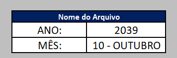

# Etapas do processo

O funcionamento da automação está dividido em 7 etapas:

### Etapa 0 — BOTÕES

O processo é iniciado por meio de botões de ação disponíveis na planilha principal do Excel.

### Etapa 1 — Inicialização

Nessa etapa, são inicializadas as variáveis e os parâmetros necessários para a execução das demais rotinas.

### Etapa 2 — Atualização dos dados

São executadas as consultas do Power Query e atualizados os dados utilizados pelas tabelas dinâmicas e pelo modelo de dados do Power Pivot.

Essa etapa garante que os relatórios trabalhem com a versão mais recente das bases disponíveis.

### Etapa 3 — Criação das pastas de armazenamento

A automação verifica a existência dos diretórios necessários para armazenar os relatórios.

Caso as pastas ainda não existam, elas são criadas automaticamente, seguindo uma organização por ano e mês de referência que estão nas células do Excel.

### Etapa 4 — Salvamento do relatório Excel

Após a atualização dos dados, é gerada uma cópia do arquivo Excel com os resultados do período.

O arquivo é armazenado no diretório histórico correspondente ao mês e ano selecionados, preservando o registro da apresentação.

### Etapa 5 — Atualização da apresentação PowerPoint

A automação abre a apresentação PowerPoint e executa as rotinas responsáveis pela atualização dos slides, gráficos e valores utilizados no relatório.

O objetivo é manter a apresentação alinhada às informações atualizadas no Excel, reduzindo a necessidade de ajustes manuais.

### Etapa 6 — Salvamento da apresentação

Após a atualização, a apresentação PowerPoint é salva no diretório histórico correspondente, seguindo o mesmo padrão de organização utilizado para o arquivo Excel.

## 3. Resultado esperado

Ao final da execução, o processo gera:

- Relatório Excel atualizado e armazenado historicamente.
- Apresentação PowerPoint atualizada.
- Organização automática dos arquivos por ano e mês.
- Preservação das versões anteriores dos relatórios.
- Redução de atividades manuais e maior padronização do processo.

## 4. Tecnologias utilizadas

- **VBA:** desenvolvimento das rotinas de automação.
- **Excel:** interface principal e armazenamento dos dados.
- **Power Query:** conexão, transformação e atualização das bases.
- **Power Pivot:** organização e modelagem dos dados.
- **PowerPoint:** geração e atualização da apresentação gerencial.